<p align="center">
  <a href="https://github.com/DariaSyanska"></a>
  
</p>

<p align="center">
  <a href="https://www.linkedin.com/in/daria-sianska"></a><a href="https://dariasyanska.github.io/portfolio/"></a><a href="mailto:daria.syanska@gmail.com"></a>
</p>

<p align="center">
  
</p>

## 🧬 about me

```javascript
const dasha = {
  role: "Frontend Developer",
  focus: ["React", "Next.js", "TypeScript", "UI/UX"],
  based: "Prague, Czech Republic",
  passionateAbout: [
    "building clean and responsive interfaces",
    "creating thoughtful user experiences",
    "writing maintainable code",
  ],
  currentlyLearning: [
    "React/Next.js architecture",
    "Testing",
    "Frontend best practices",
  ],
  languages: ["Ukrainian", "Russian", "English", "Czech"],
  goal: "Keep growing as a developer and build products people love",
};
```

I'm a frontend developer who enjoys turning ideas into functional, accessible, and visually appealing websites.

I love working with modern frontend technologies, exploring UI design, and finding elegant solutions to everyday development challenges.

## 🌱 currently

- Deepening my React/Next.js and TypeScript skills
- Building and refining my portfolio
- Exploring modern UI patterns and frontend architecture
- Looking for opportunities to grow as a frontend developer

## 🚀 featured projects

<table>
  <tr>
    <td width="50%" valign="top">
      <h3>💼 <a href="https://crm-self-one.vercel.app/">CRM SaaS Platform</a></h3>
      <sub><b>Full-Stack · SaaS Dashboard</b></sub>
      <p>A CRM platform for managing clients, deals, tasks, and sales pipelines.</p>
      <ul>
        <li>Drag & drop Kanban pipeline</li>
        <li>Analytics dashboard with KPIs and charts</li>
        <li>Authentication and API integration</li>
        <li>Responsive dark/light interface</li>
      </ul>
      <p>
        <code>Next.js</code>
        <code>React</code>
        <code>TypeScript</code>
        <code>FastAPI</code>
        <code>PostgreSQL</code>
      </p>
      <a href="https://github.com/DariaSyanska/crm">
        
      </a>
    </td>
    <td width="50%" valign="top">
      <h3>🌙 <a href="https://dariasyanska.github.io/lune-shop/">Lune Fashion Store</a></h3>
      <sub><b>E-commerce · Frontend UI/UX</b></sub>
      <p>A modern fashion storefront concept focused on elegant design and interactive shopping experiences.</p>
      <ul>
        <li>Dynamic product catalog</li>
        <li>Shopping cart and wishlist</li>
        <li>Light/dark theme system</li>
        <li>GSAP animations and responsive layouts</li>
      </ul>
      <p>
        <code>HTML</code>
        <code>SCSS</code>
        <code>JavaScript</code>
        <code>GSAP</code>
        <code>Vite</code>
      </p>
      <a href="https://github.com/DariaSyanska/lune-shop">
        
      </a>
    </td>
  </tr>
  <tr>
    <td width="50%" valign="top">
      <h3>🎓 <a href="https://dariasyanska.github.io/kraus-academy/">Kraus Academy</a></h3>
      <sub><b>Landing Page · Frontend</b></sub>
      <p>A responsive landing page for a kitchen-design academy, created to present courses and guide visitors toward enquiries.</p>
      <ul>
        <li>Responsive landing page</li>
        <li>Interactive hero slider</li>
        <li>Student reviews gallery</li>
        <li>Scroll-based interactions</li>
      </ul>
      <p>
        <code>HTML5</code>
        <code>CSS3</code>
        <code>JavaScript</code>
        <code>Intersection Observer</code>
      </p>
      <a href="https://github.com/DariaSyanska/kraus-academy">
        
      </a>
    </td>
    <td width="50%" valign="top">
      <h3>🎨 <a href="https://dariasyanska.github.io/portfolio/">Personal Portfolio</a></h3>
      <sub><b>Portfolio · UI/UX · Frontend</b></sub>
      <p>My personal portfolio showcasing my frontend projects, technical skills, and approach to building modern web interfaces.</p>
      <p>
        <code>HTML</code>
        <code>CSS</code>
        <code>JavaScript</code>
        <code>UI/UX</code>
      </p>
      <a href="https://github.com/DariaSyanska">
        
      </a>
    </td>
  </tr>
</table>

## 🧰 tech stack

<p align="center">
  
</p>

## 📊 GitHub stats

<p align="center">
  
  
</p>

<p align="center">
  
</p>

<p align="center">
  <b>Have an interesting project in mind? Let's build something cool.</b>
</p>

<p align="center">
  <a href="mailto:daria.syanska@gmail.com">
    
  </a>
</p>

<p align="center">
  
</p>
